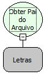

Descrição:

Obtém a pasta que contém o arquivo especificado.

Parâmetros:

1. Caminho absoluto do arquivo.

Retorno:

Caminho da pasta que contém o arquivo.

Nome Real:

ebfFileGetParent

Compatibilidade:

Banco de dados e Servidor
