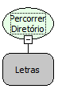

Descrição:

Percorre o diretório passado por parâmetro e retorna uma lista com todos os arquivos e pastas contidos nesse diretório.

Parâmetros:

1. Corresponde ao diretório que será percorrido. O tipo é Letras, pois deverá ser informado manualmente o endereço do diretório.

Retorno:

Lista com os arquivos e diretórios contidos no diretório passado por parâmetro. (Variante)

Exemplo:

1. Assumindo como parâmetro c:/softwell (Sendo que dentro da pasta possui um arquivo Maker.txt e a pasta Webrun). O retorno será uma Lista com os elementos &#123;c:/softwell/Maker.txt, c:/softwell/webrun&#125;.

2. Assumindo como parâmetro \\192.168.1.50\softwell (pasta compartilhada - sendo que dentro da pasta possui um arquivo Maker.txt e a pasta Webrun). O retorno será uma Lista com os elementos &#123;\192.168.1.50\softwell\Maker.txt, \192.168.1.50\softwell&#125;.

Observação:

O retorno dessa função pode ser facilmente manipulado pelas funções da categoria lista. Para verificar se um elemento da lista é arquivo ou diretório, utilize as funções "É diretório?" e "É arquivo?" da categoria "Arquivo". Para que haja sucesso no uso da função, é necessário que o usuário que a utiliza tenha permissão de acesso aos diretórios e a pasta esteja compartilhada. Caso no diretório passado como parâmetro possua sub-diretórios com arquivos dentro, eles não serão retornados. A função percorre somente o diretório corrente.

Nome Real:

ebfPercorreDirectory

Compatibilidade:

Banco de dados e Servidor
