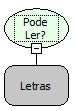

Descrição:

Verifica se é possível ler um determinado arquivo no servidor.

Parâmetros:

1. Caminho absoluto do arquivo

Retorno:

Verdadeiro caso o arquivo possa ser lido. Caso contrário retorna Falso.

Nome Real:

ebfFileCanRead

Compatibilidade:

Banco de dados e Servidor
