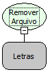

Descrição:

Remove uma pasta ou arquivo no servidor

Parâmetros:

1. Local da pasta ou arquivo a ser deletado

Retorno:

Não possui.

Exemplos:

1. Assumindo que o parâmetro seja "C:\MakerFlow", caso a pasta exista, ela será apagada.'

2. Assumindo que o parâmetro seja "C:\MakerFlow\maker.txt", caso o arquivo exista, ele será apagado

Nome Real:

ebfFileRemove

Compatibilidade:

Banco de dados e Servidor
