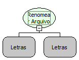

Descrição:

Renomeia o arquivo especificado.

Parâmetros:

1. Caminho absoluto do arquivo original.

2. Novo nome do arquivo (com extensão (Não necessita do caminho absoluto).

Retorno:

Não possui.

Nome Real:

ebfFileRename

Compatibilidade:

Banco de dados e Servidor
