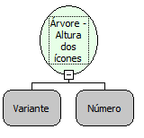

Descrição:

Altera a altura dos ícones da árvore para a passada por parâmetro

Parâmetros:

1. Árvore

2. Nova altura dos ícones

Exemplo:

Assumindo como parâmetros a referência para a árvore e 20, a altura dos ícones será alterada para 20.

Nome Real:

ebfSetIconsHeight

Compatibilidade:

Cliente
