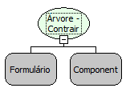

Descrição:

Contrai todos os nós da árvore.

Parâmetros:

1. Formulário que contém a árvore

2. Componente Árvore

Retorno:

Não possui

Observação:

Para que a função funcione corretamente a propriedade ""Carga Postergada"  deve está desativada

Nome Real:

ebfTreeviewCollapseAll.

Compatibilidade:

Cliente e Servidor.
