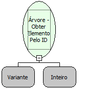

Descrição:

Função que retorna um elemento da árvore a partir do seu ID.

Parâmetros:

1. Árvore na qual o elemento se encontra

2. ID do elemento desejado

Retorno:

Retorna a referência do elemento. (Variante)

Nome Real:

ebfTreeGetElementById

Compatibilidade:

Cliente
