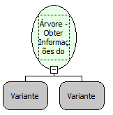

Descrição:

Obter Informações do Elemento

Parâmetros:

1. Árvore.

2. Elemento.

Retorno:

Informação (Letras)

Exemplo:

Assumindo os parâmetros como "Árvore" (Variante), "Elemento" (Variante). Caso haja alguma informação sobre o elemento passado por parâmetro, ela será retornada para uma variável do tipo Letras.

Observação:

Para o funcionamento correto da função, o arquivo imagem necessáriamente deve estar na pasta "Skins/Default/" do seu servidor.

Nome Real:

ebfTreeGetElementDBInfo

Compatibilidade:

Cliente
