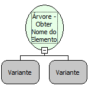

Descrição:

Obtem o nome do Elemento passado como parâmetro

Parâmetros:

1. Árvore

2. Elemento (Referência)

Retorno:

Retorna o Nome do Elemento.

Nome Real:

ebfTreeGetElementDesc

Compatiblidade:

Cliente
