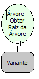

# Árvore - Obter Raiz da Árvore

Descrição:

Obtém o elemento raiz da árvore passada por parâmetro.

Parâmetros:

1. Árvore

Retorno:

Raiz da árvore (Variante).

Observação:

A árvore pode ser obtida através da função "Obter Componente" da categoria Formulário.

Nome Real:

ebfGetRoot

Compatibilidade:

Cliente
