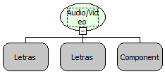

Descrição:

Recebe um stream de um de um servidor de Áudio/Vídeo Conferência no padrão Flash Media Server.

Parâmetros:

1. Host ou IP Servidor Flash Media Server;

2. Identificador do Stream;

3. Moldura em que o vídeo será exibido.

Retorno:

Não possui.

Nome Real:

ebfLoadFMSClient

Compatibilidade:

Cliente e Servidor
