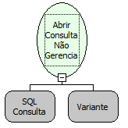

Descrição:

Função usada para fazer uma consulta no Banco de Dados, atribuindo esta consulta em uma variável do tipo tabela. Exerce quase a mesmo papel da função (Abrir Consulta , com a única diferença que a consulta não é fechada automaticamente, sendo necessário usar a função (Fechar Consulta). Vide descrições das funções (Abrir Consulta) e (Fechar Consulta).

Parâmetros:

1. Consulta (feito no Wizard SQL).

2. Conexão ao Banco de Dados (Opcional).

Retorno:

Retorna a consulta passada pelo 1º Parâmetro.

Exemplo:

1. Seleciona a função Abrir Consulta Não Gerenciada.

2. Define a consulta a ser realizada no Wizard SQL.

3. Atribui o retorno a uma variável tabela.

4. Fecha a Consulta com a função (Fechar Consulta).

Observações:

1. É necessário que após a utilização da consulta criada pela função (Abrir Consulta Não Gerenciada) a mesma seja

fechada com a função (Fechar Consulta).

2. Caso seja utilizada a função "Obter Conexão Adicional" no segundo parâmetro, as entidades do banco de dados

da conexão adicional aparecerão automaticamente no "Wizard SQL".

3. Caso seja utilizada funções de "Abrir Conexão MySQL/FireBird/Oracle..." não será possível montar a consulta por diagrama.

Nome Real:

ebfSQLExecuteQueryUnmanaged

Compatibilidade:

Banco de dados e Servidor
