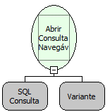

Descrição:

Executa um comando de Seleção no Banco de Dados e permite navegação nesses dados. Permite o uso das funções Próximo Registro, Registro Anterior, Último Registro, Primeiro Registro e Ir para Registro da categoria Banco de Dados. Permite também o uso na função Modificar Consulta do Formulário ou Grade.

Parâmetros:

1. Comando de Seleção ou Wizard.

2. Conexão com o banco de dados. É  opcional (se passado nulo, a função assume que a consulta será feita na conexão principal).

Retorno:

Retorna uma Consulta  que pode ser atribuída a uma Variável Tabela.

Exemplo:

1º Parâmetro - o comando de Seleção que será passado para o banco de dados. Para montar esse comando visualmente é necessário clicar no botão "Wizard SQL" que se localiza do lado direito da tela.

2º Parâmetro (conexão) - é opcional. Caso seja necessário executar a consulta em um outro banco de dados, é necessário passar a conexão para este. Para criar essa conexão consulte a ajuda sobre a função "Abrir Conexão MSSQL" ou "Abrir Conexão Firebird".

Observações:

1. Essa função é usada para fazer um SELECT (seleção) no banco de dados desejado.

2. Caso seja utilizada a função "Obter Conexão Adicional" no segundo parâmetro, as entidades do banco de dados da conexão adicional aparecerão automaticamente no "Wizard SQL".

3. Caso seja utilizada funções de "Abrir Conexão MySQL/FireBird/Oracle..." não será possível montar a consulta por diagrama.

Nome Real:

ebfSQLExecuteScrollQuery

Compatibilidade:

Servidor
