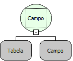

Descrição:

Essa função recebe como parâmetro o resultado de uma consulta e uma constante do tipo campo.  A função procura dentro da consulta SQL, a constante do tipo campo que foi passada como parâmetro e retorna o conteúdo da mesma.

Parâmetros:

1. Resultado de uma consulta (Tabela).

2. Campo

Retorno:

Retorna o Valor do Campo desejado.

Observações:

1. Essa função é usada para obter um campo de uma SELECT (Comando de Seleção do Banco de Dados).

2. A consulta geralmente é uma consulta SQL feita através da função "Abrir Consulta" da categoria banco de dados.

Nome Real:

ebfSQLField

Compatibilidade:

Banco de dados e Servidor
