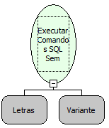

Descrição:

Essa função recebe como parâmetro uma constante do tipo letras, onde dentro dessa constante pode conter um

ou vários comandos SQL que serão executados sem estar em uma transação. Essa função executa o(s) comando(s)

SQL no banco de dados.

Parâmetros:

1. Comando SQL a ser executado.

2. Conexão com outro banco de dados (opcional)

Retorno:

Retorna NULO caso o comando SQL seja executado com sucesso. Caso haja algum erro, este será retornado.

Exemplo:

1º Parâmetro : INSERT INTO EMPRESA (CODIGO, DESCRICAO) VALUES (1,"Softwell").

Nome Real:

ebfSQLExecuteBatchNoTransaction

Compatibilidade:

Servidor
