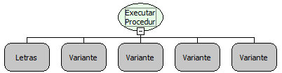

Descrição:

Essa função executa uma procedure do banco de dados.

Parâmetros:

1. Nome da procedure a ser executada

2. Lista contendo parâmetros de entrada da procedure (Nulo se a procedure não tiver parâmetros de entrada)

3. Conexão (Caso a conexão seja nula, será usada a conexão principal do sistema)

4. Uma lista de número referente ao tipo de dados que serão retornados (Verificar número correspondente na tabela)

5. Uma lista de Tipos Complexos

Retorno:

Uma lista de Variantes

Segue a tabela com os tipos que podem ser retornados:

       12 - VARCHAR

         2 - NUMERIC

       16 - BOOLEAN

       91 - DATE

       92 - TIME

       93 - TIMESTAMP

         8 - DOUBLE

         6 - FLOAT

         7 - REAL

       - 2 - BINARY

         1 - CHAR

   2004 - BLOB

   2005 - CLOB

         5 - BIGINT

     - 10 - CURSOR (ORACLE) (É necessário avançar para o primeiro registro)

Observações:

1. Se no lugar da lista informada do quarto parâmetro for fornecido um valor nulo, a função entenderá que a procedure não possui retorno.

- 1. procedureExecutarComando
- 2. valores de entrada
- 3. conexão
- 4. retornos (12,8)
- - Legenda  referente aos elementos de retorno da procedure
  - Primeiro elemento da lista   = Tipo 12 (Varchar)
  - Segundo elemento da lista = Tipo 8 (Double)
  - Lista (tipo_complexo_1, tipo_complexo_2)

2. Os numeros que forem inclusos na lista do 4º parâmetro devem ser do tipo INT.

3. Função para banco de dados Oracle
