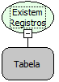

Descrição:

Essa função recebe como parâmetro uma consulta SQL que vai estar armazenada em uma variável tabela e verifica se existem

registros na consulta, ou seja, se retorna algum resultado.  Essa função tem o retorno do tipo lógico. Caso haja algum resultado retornará então verdadeiro, caso contrário retornará falso.

Parâmetros:

1. Consulta SQL

Retorno:

Retorno do tipo Lógico.

Observação:

Essa função é mais usada para decisões por ter um retorno lógico.

Exemplos:

1º Parâmetro: Tabela

Retorno: True (se houver registros) ou False (se não houver registros)

Nome Real:

ebfSQLEOF

Compatibilidade:

Banco de dados e Servidor
