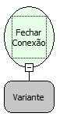

Descrição:

Essa função fecha uma conexão com o banco de dados impedindo que seja emitido qualquer comando para o banco de

dados da conexão que foi fechada. Essa função recebe a variável que foi armazenada a conexão.

Parâmetros:

1. Conexão

Retorno:

Fecha a Conexão passado como parâmetro.

Exemplo:

1. Conexão

Observação:

Essa função é usada para fechar a conexão que não seja mais útil.

Nome Real:

ebfSQLCloseConnection

Compatibilidade:

Banco de dados e Servidor
