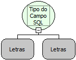

Descrição:

Função usada para retornar o tipo de campo da consulta e do campo passado como parâmetro, ambos como constantes do tipo Letras. Tem a mesma funcionalidade da função (Retornar Tipo Campo), com a diferença de que todos os seus parâmetros são constantes do tipo Letras. Vide descrição da função (Retornar Tipo Campo).

Parâmetros:

1. Consulta (tipo Letras).

2. campo (tipo Letras).

Retorno:

Retorna o tipo de campo (varchar, int...).

Exemplo:

1. Use a função Tipo do Campo SQL.

2. Passe como 1º parâmetro uma constante do tipo Letras com a consulta, e 2º parâmetro o campo.

3. Atribua o valor de retorno a uma variável do tipo Letras.

Observação:

O 2º parâmetro deve ser uma constante Letras, explicitando o nome do campo que deseja retornar o tipo.

Nome real:

ebfGetSQLMetaDataField

Compatibilidade:

Banco de dados e Servidor
