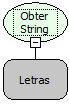

Descrição:

Essa função ativa o leitor para a captura da string biométrica de uma digital.

Parâmetros:

1. Nome da regra que irá receber a String da digital, esta regra deve ter um parâmetro de entrada do tipo Letras.

Retorno:

Não possui.

Exemplo:

Essa função recebe como parâmetro um Fluxo e no mesmo é obrigatório que tenha um parâmetro de entrada (String Biométrica) que vai ser passado pela função.

Nome Real:

ebfOpenRuleDigitalCaptureString

Compatibilidade:

Cliente
