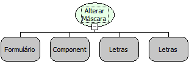

Descrição:

Altera a máscara de um componente.

Parâmetros:

1. Formulário que contém o componente

2. Nome do componente

3. Nova máscara

4. Tipo da máscara (Letras, Número ou Data)

Retorno:

Não possui.

Nome Real:

ebfComponentSetMask

Compatibilidade:

Todas as camadas
