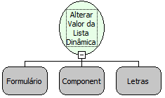

Descrição:

Função que altera o valor exibido na lista dinâmica.

Parâmetros:

1. Formulário onde se encontra o componente do tipo Lookup.

2. Componente Lista Dinâmica.

3. Valor que será exibido na lista dinâmica.

Retorno:

Não possui.

Nome Real:

ebfFormSetLookupName

Compatibilidade:

Cliente
