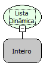

Descrição:

Define o tipo de filtro que deve ser executado para todas as Listas Dinâmicas do formulário.

Parâmetros:

1. Tipo de filtro: 1- Igual, 2- Contendo, 3- Iniciando com, 4- Terminando com

Retorno:

Não possui.

Nome Real:

ebfDynamicListDefineAllFilterType

Compatibilidade:

Cliente e Servidor.
