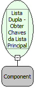

Descrição:

Retorna uma lista com os valores dos campos chaves dos itens da lista principal do componente lista dupla

Parâmetros:

1. Componente do tipo Lista Dupla

Retorno:

Retorna uma Lista que deve ser atribuída a uma variável do tipo variante.

Nome Real:

ebfGetDualListLeftValue

Compatibilidade:

Cliente
