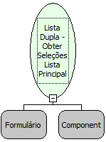

Descrição:

Retorna uma lista com os valores dos campos chaves selecionados dos itens da lista principal do componente lista dupla.

Parâmetros:

1. Formulário que contém a Lista Dupla

2. Componente do tipo Lista Dupla

Retorno:

Retorna uma Lista com os selecionados da lista principal (Variante).

Nome Real:

ebfDualListGetLeftSelectedValues

Compatibilidade:

Cliente
