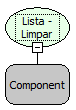

Descrição:

Essa função remove todos os elementos do componente Lista. Passando como parâmetro a componente Lista.

Parâmetros:

1. Nome do componente Lista

Retorno:

O retorno será os elementos da Lista apagadas.

Exemplo:

Assumindo o 1º parâmetro: Carros(Lista) contendo os elementos 1 - Usado e 2 - Novo, sendo 1 e 2 o valor chave e "Usado e Novo" o valor que representam o valor chave. O retorno será a lista Carros com os elementos removidos.

Nome Real:

ebfComboClean

Compatibilidade:

Todas as camadas
