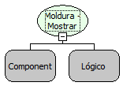

Descrição:

Esta função mostra ou oculta o componente moldura e todos os componentes que estiverem "dentro" da área do mesmo.

Parâmetros:

1. Moldura

2. Valor lógico que exibe ou oculta os componentes.

Retorno:

Não possui.

Nome Real:

ebfGroupBoxShowComponents

Compatibilidade:

Cliente
