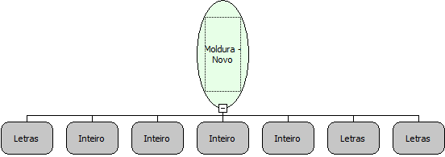

Descrição:

Função que cria um novo componente Moldura dinâmicamente.

Parâmetros:

1. Aba (caso não seja definida, a aba será criada).

2. Posição X.

3. Posição Y.

4. Largura do componente.

5. Altura do componente.

6. Descrição do componente.,

7. Nome do componente

Retorno:

Não possui.

Nome Real:

ebfGroupBoxNew

Compatibilidade:

Cliente
