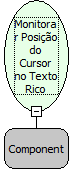

Descrição:

Monitora a posição do cursor no Texto Rico.

Parâmetros:

1. Nome do Componente

Retorno:

Não possui.

Observações:

1. Só há necessidade do uso desta função no Internet Explorer.

2. Deve-se utilizar esta função no evento "Ao Entrar" do formulário.

Nome Real:

ebfRichTextInsertTextAtPosition

Compatibilidade:

Cliente
