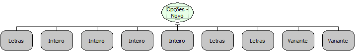

Descrição:

Função que cria um novo componente Opções dinâmicamente.

Parâmetros:

1. Aba (Caso a aba definida neste parâmetro não exista, a mesma será criada).

2. Posição X.

3. Posição Y.

4. Largura do Componente.

5. Altura do Componente

6. Descrição do Componente

7. Valor do Componente

8. Lista de Labels

9. Lista de Valores

Retorno:

Não Possui.

Nome Real:

ebfRadioGroupNew

Compatibilidade:

Cliente
