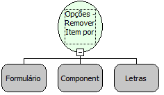

Descrição:

Função que remove um item do componente Opções tomando o label do item como referência.

Parâmetros:

1. Formulário onde está localizado o componente Opções.

2. Componente

3. Label do item a ser removido

Retorno:

Não possui.

Nome Real:

ebfRadioGroupRemoveByLabel

Compatibilidade:

Cliente
