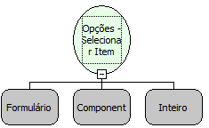

Descrição:

Função que seleciona o item do componente Opções.

Parâmetros:

1. Formulário.

2. Componente.

3. Índice do item que se deseja selecionar. (O primeiro item tem índice 0).

Retorno:

Não possui.

Observação:

O índice dos items estão na ordem de N-1.

Nome Real:

ebfRadioGroupSetChecked

Compatibilidade:

Cliente
