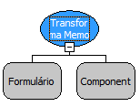

# Transformar Memo em Texto Rico Básico

Descrição

Recebe um componente memo e transforma em texto rico básico.

Parâmetros:

1. Formulário onde está localizado o componente Memo.

2. Componente memo.

Retorno:

Não possui

Nome Real:

ebfMemoToBasicRichText

Compatibilidade:

Cliente e Servidor
