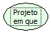

Descrição:

Verifica em que modo o projeto se encontra.

Parâmetros:

Não possui.

Retorno (Letras) :

P - Modo de Permissão (Gerente).

D - Modo de Projeto (Desenvolvimento).

N - Modo Normal.

Exemplo:

Não possui
