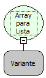

Descrição:

Transforma um conjunto de elementos que não podem ser manipulados pelas funções da categoria lista em um conjunto de elementos que podem ser manipulados por essas funções.

Parâmetros:

1. Array(Vetor)

Retorno:

Objeto lista com os elementos contidos no array (Variante)

Exemplo:

Ao obter uma imagem de um banco de dados e utilizar a função "Para Byte", da categoria conversão, ela vem como um array(Vetor) de bytes que não podem ser acessados utilizando as funções da categoria lista, logo é necessária essa conversão para que esse elementos possam ser manipulados.

Nome Real:

ebfConvertArrayToList

Compatibilidade:

Banco de dados e Servidor
