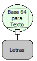

Descrição:

Converte um Texto codificado na Base64 para Texto Normal. A Base 64 é usada para codificar dados.

Parâmetros:

1. Texto em Base 64

Retorno:

O Texto normal em letras.

Observação:

As especificações completas deste tipo de Base64 são dadas pelas RFC 1421 e RFC 2045. ( RFC é uma sigla de Request for Comments, ele é um documento que descreve os padrões de cada protocolo da Internet previamente a serem considerados como um padrão).

Exemplo:

Assumindo como parâmetro o texto codificado em Base 64 TWFrZXI=, o retorno será  MAKER.

Nome Real:

ebfBase64ToString

Compatibilidade:

Banco de dados e Servidor
