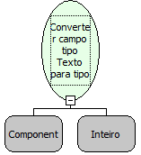

Descrição:

Essa função converte um Componente "Caixa de Texto" para um componente "Caixa de Texto" do tipo Arquivo. Através dela você poderá selecionar um arquivo do sistema.

Parâmetros:

1. Componente do tipo texto que será convertido em um do tipo arquivo.

2. Quantidade de caracteres (aproximados) que aparecerão. O Firefox 3 necessita dessa propriedade para alterar a largura.

Exemplos:

Assumindo que um Componente do tipo Texto no formulário. O uso desta converterá o Componente em um do tipo arquivo.

Observações:

1. O componente não pode estar relacionado a um campo do banco de dados.

2. O navegador Mozilla FireFox, por questões de segurânça, não permite que todo o caminho do arquivo seja retornado, apenas o nome do arquivo e a extensão.

3. O navegdaor Chrome não permite a alteração para o tipo arquivo.

Nome Real:

ebfConverterInputTextInFile

Compatibilidade:

Cliente
