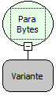

Descrição:

Converte um valor passado por parâmetro para Bytes.

Parâmetros:

1. Conteúdo que será convertido para bytes.

Retorno:

Array de Bytes equivalente ao conteúdo passado por parâmetro.

Exemplo:

Assumindo o parâmetro "Maker", será retornado um aray de bytes equivalente à palavra Maker.

Observação:

Para manipular os bytes de retorno dessa função é necessária a utilização da função "Array para Bytes" da categoria "Conversão".  Após convertido pra lista o conteúdo poderá ser manipulado pelas funções da categoria "Lista".

Nome Real:

toBytes

Compatibilidade:

Todas as camadas
