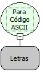

Descrição:

Converte o caractere passado por parâmetro para código ASCII.

Parâmetros:

1. Caractere do qual se deseja obter o código ASCII.

Retorno:

Código ASCII do caractere passado por parâmetro.

Exemplo:

Assumindo o parâmetro como "d" o retorno será  100.

Observação:

A Tabela ASCII (American Standard Code for Information Interchange) é usada pela maior parte das industrias de computadores para a troca de informações. Cada caractere é representado por um código de 8 bits(um byte).

Nome Real:

ebfChrToAscii

Compatibilidade:

Todas as camadas
