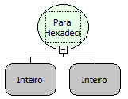

Descrição:

Converte um número para hexadecimal com zeros a esquerda caso o número a ser convertido seja menor que a quantidade de caracteres a ser retornada.

Parâmetros:

1. Valor a ser convertido.

2. Quantidade de Caracteres a ser retornada

Retorno:

Valor convertido para Hexadecimal.

Exemplo:

Assumindo como parâmetros 10 e 8,  o retorno será 0000000A.

Observação:

Hexadecimal é um sistema numérico com 16 dígitos, onde os dígitos de 0 a 9 são representados por números de 0 a 9, e os dígitos de 10 a 15 são representados por letras, que vão de A a F.

Nome Real:

ebfIntToHex

Compatibilidade:

Todas as camadas
