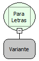

Descrição:

Converte um valor passado por parâmetro para letras.

Parâmetros:

1. Valor a ser convertido.

Retorno:

Valor convertido para Letras.

Exemplo:

Assumindo como parâmetro o fracionado 7.4, o retorno será o valor 7.4 convertido para letras.

Nome Real:

toString

Compatibilidade:

Todas as camadas
