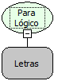

Descrição:

Converte para valor lógico o texto passado por parâmetro.

Parâmetros:

1. Texto que será convertido para lógico.

Retorno:

Valor lógico correspondente ao texto enviado.

Exemplos:

1. Assumindo como parâmetro o conteúdo " 1", o retorno será o valor lógico verdadeiro.

2. Assumindo como parâmetro o conteúdo " 0 ", o retorno será o valor lógico falso.

Nome Real:

toBoolean

Compatibilidade:

Todas as camadas
