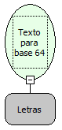

Descrição:

Converte um Texto Normal para um Texto codificado na Base64. A Base 64 é usada para codificar dados.

Parâmetros:

1. Texto normal em letras.

Retorno:

Texto em Base 64. (Letras).

Observação:

As especificações completas deste tipo de Base64 são dadas pelas RFC 1421 e RFC 2045. ( RFC é uma sigla de Request for Comments, ele é um documento que descreve os padrões de cada protocolo da internet previamente a serem considerados como um padrão).

Exemplo:

Assumindo como parâmetro o texto Maker, o retorno será o texto codificado em Base 64 "TWFrZXI=".

Nome Real:

ebfStringToBase64.

Compatibilidade:

Banco de dados e Servidor.
