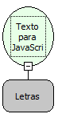

Descrição:

Converte para o formato Texto removendo os caracteres especiais de JavaScript.

Parâmetros:

1. Texto normal para ser convertido para o formato padrão JavaScript.

Retorno:

Texto passado por parâmetro convertido para o Padrão JavaScript. (Letras)

Exemplo:

Assumindo como parâmetro o conteúdo "", o retorno será "\r", pois "" é um caractere especial JavaScript.

Nome Real:

ebfStringToJs

Compatibilidade:

Todas as camadas
