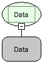

Descrição:

Essa função retira as horas da data, retornando apenas a Data com as horas zeradas.

Parâmetros:

1. Data com Hora.

Retorno:

Retorna a data com as horas zeradas.

Exemplos:

1. Assumindo que o 1º parâmetro seja 23/09/2008 23: 30: 00. O retorno será 23/09/2008 00:00:00.

2. Assumindo que o 1º parâmetro seja 10/12/1998 11: 52: 25. O retorno será 10/12/1998 00:00:00.

Nome Real:

ebfDateDate

Compatibilidade:

Cliente e Servidor
