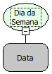

Descrição:

Essa função retorna o dia da semana a partir da data passada como parâmetro.

Parâmetros:

1. Data que você deseja saber o dia da semana

Retorno:

Retorna um número inteiro que representa o dia da semana (1 = Domingo; 2 = Segunda-Feira; 3 = Terça-Feira; 4 = Quarta-Feira; 5 = Quinta-Feira; 6 = Sexta-Feira; 7 = Sábado).

Exemplos:

1. Assumindo que o 1º parâmetro seja 23/09/2007. O retorno será 1, pois o dia a data cai no domingo.

2. Assumindo que o 1º parâmetro seja 04/10/2007. O retorno será 5, pois a data cai na quinta-feira.

Nome Real:

getDayOfWeek

Compatibilidade:

Servidor
