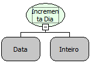

Descrição:

Essa função incrementa o dia de uma data passada por parâmetro.

Parâmetros:

1. Data que deseja incrementar o dia

2. Valor a ser incrementado no dia

Retorno:

Retorna a data com o dia incrementado.

Exemplo:

Assumindo que o 1º parâmetro seja 22/09/2008 e o 2º parâmetro seja 2 . O retorno será 24/09/2008.

Nome Real:

ebfDateIncDay

Compatibilidade:

Todas as camadas
