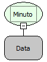

Descrição:

Essa função obtém os minutos de uma data passada por parâmetro.

Parâmetros:

1. Data que será extraído os minutos

Retorno:

Retorna os minutos da data passada por parâmetro. O retorno pode ser atribuído a uma variável do tipo inteiro.

Exemplo:

Assumindo que o 1º parâmetro seja 02/11/2010 12: 53: 26. O retorno será 53.

Observação:

Se no primeiro parâmetro for passada uma data sem os minutos, a função retornará o valor 0(zero).

Nome Real:

ebfDateMinute

Compatibilidade:

Cliente e Servidor
