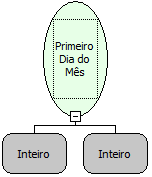

Descrição:

Essa função a partir do mês e ano passado por parâmetro retorna a data com o primeiro dia do mês.

Parâmetros:

1. Mês

2. Ano

Retorno:

Retorna a data com o primeiro dia do mês.

Exemplo:

Assumindo o 1º parâmetro sendo 02 e o 2º parâmetro sendo 2007, o retorno será 01/02/2007 00:00:00.

Nome Real:

ebfFirstDay

Compatibilidade:

Servidor
